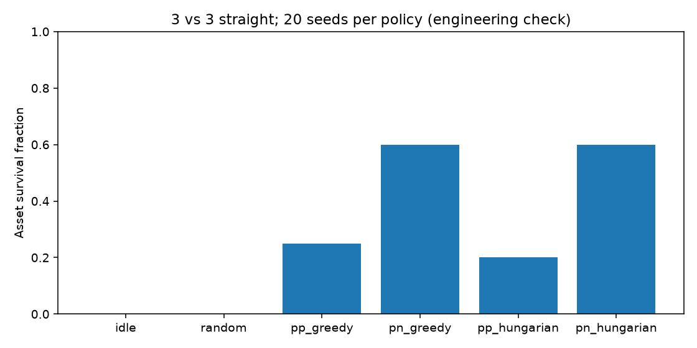

# M2 integration / M3 GNC engineering check

Question: do the real controller, primitives, baselines, sensing, packed graphs,
and parallel worlds connect with correct episode boundaries?
Outcome: 26 C++ tests and 6 Python tests pass; schema generation is current.
PN + greedy survives 12/20 fixed 3-vs-3 straight episodes; idle and random survive
0/20. No baseline episodes truncate. These are small engineering measurements,
not the full M3 evaluation suite or a scientific result.

See [report.md](report.md) for commands, diagnosis, assumptions and measurements,
[metrics.json](metrics.json) for individual episodes, and [GNC API documentation](../../gnc/README.md).

