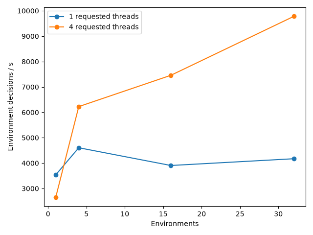

# Environment throughput

| Envs | Requested threads | Decisions/s |
| ---: | ---: | ---: |
| 1 | 1 | 3537 |
| 1 | 4 | 2653 |
| 4 | 1 | 4605 |
| 4 | 4 | 6225 |
| 16 | 1 | 3906 |
| 16 | 4 | 7459 |
| 32 | 1 | 4172 |
| 32 | 4 | 9779 |

Reset is excluded; 200 batched decisions per point include real simulation, perception and packing. Other learner work was active, so use these values to choose an initial pool size, not to claim maximum throughput.
