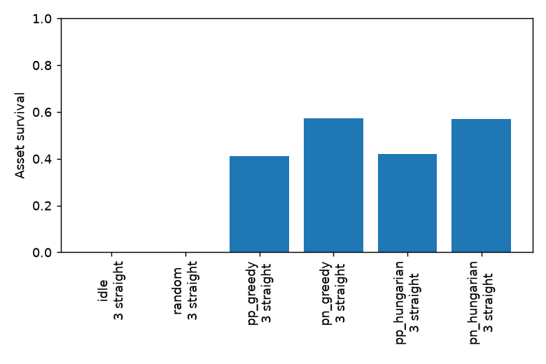

# Evaluation report

| Policy | Red | Behaviour | Survival (95% CI) | Intercept fraction | Truncated |
| --- | ---: | --- | --- | ---: | ---: |
| idle | 3 | straight | 0.000 [0.000, 0.004] | 0.003 | 0 |
| random | 3 | straight | 0.000 [0.000, 0.004] | 0.001 | 0 |
| pp_greedy | 3 | straight | 0.410 [0.380, 0.441] | 0.657 | 0 |
| pn_greedy | 3 | straight | 0.573 [0.542, 0.603] | 0.751 | 0 |
| pp_hungarian | 3 | straight | 0.419 [0.389, 0.450] | 0.664 | 0 |
| pn_hungarian | 3 | straight | 0.570 [0.539, 0.600] | 0.752 | 0 |

## Primitive tuning diagnosis

The first proxy quantised the PN command and then fed that quantised value back into PN. That discarded sub-primitive course corrections, freezing the steering course. `tuning_initial.log` preserves that failed diagnostic. The corrected proxy retains a continuous PN command independently from the primitive decoder. Every one of 12 magnitude combinations captures 3/3 non-manoeuvring test targets (`tuning.log`); the original assertion remains unchanged and passes.

Retain the YAML defaults: turn 20 degrees, horizontal speed increment 3 m/s, climb increment 3 m/s. Mean clear time is 8.86 s for that combination; 30 degrees gives 8.843 s on these three geometries, too little improvement to justify a coarser turn. Speed step 1.5 is slightly slower; climb 1.5 does not improve this test. These engineering cases establish primitive capability, not an optimal learned action vocabulary.

The 1,000-episode table is the current-sampler M3 baseline record. The full 16-condition suite is implemented in scenarios/v0/eval.yaml; the first table is one condition, not a claim to have run all 96,000 baseline episodes. Baseline latency includes the environment step; use the dedicated M5 sweep for graph-plus-inference comparisons.
