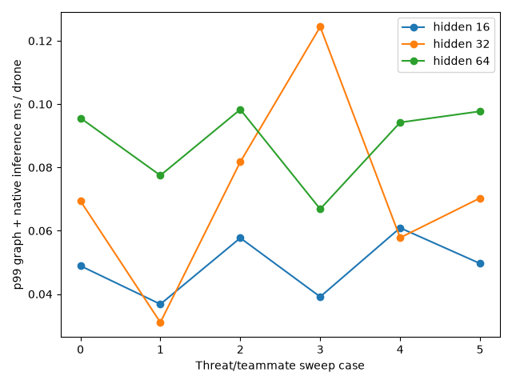

# Runtime parity and latency

Parity: 1000 recorded observations, max absolute Q error 5.96e-08 (required <1e-4).

| Hidden | Threats | Teammates | Parameters | p50 ms | p99 ms | Tracking ms |
| ---: | ---: | ---: | ---: | ---: | ---: | ---: |
| 16 | 3 | 2 | 8043 | 0.0268 | 0.0489 | 0.0011 |
| 16 | 3 | 4 | 8043 | 0.0192 | 0.0368 | 0.0018 |
| 16 | 6 | 2 | 8043 | 0.0304 | 0.0577 | 0.0021 |
| 16 | 6 | 4 | 8043 | 0.0215 | 0.0391 | 0.0018 |
| 16 | 12 | 2 | 8043 | 0.0355 | 0.0609 | 0.0125 |
| 16 | 12 | 4 | 8043 | 0.0267 | 0.0497 | 0.0100 |
| 32 | 3 | 2 | 27819 | 0.0395 | 0.0694 | 0.0011 |
| 32 | 3 | 4 | 27819 | 0.0197 | 0.0310 | 0.0009 |
| 32 | 6 | 2 | 27819 | 0.0324 | 0.0817 | 0.0021 |
| 32 | 6 | 4 | 27819 | 0.0226 | 0.1244 | 0.0018 |
| 32 | 12 | 2 | 27819 | 0.0398 | 0.0578 | 0.0060 |
| 32 | 12 | 4 | 27819 | 0.0507 | 0.0703 | 0.0049 |
| 64 | 3 | 2 | 102699 | 0.0351 | 0.0956 | 0.0011 |
| 64 | 3 | 4 | 102699 | 0.0276 | 0.0775 | 0.0010 |
| 64 | 6 | 2 | 102699 | 0.0453 | 0.0983 | 0.0021 |
| 64 | 6 | 4 | 102699 | 0.0345 | 0.0669 | 0.0035 |
| 64 | 12 | 2 | 102699 | 0.0548 | 0.0942 | 0.0083 |
| 64 | 12 | 4 | 102699 | 0.0540 | 0.0977 | 0.0049 |

CPU ONNX Runtime 1.23.2 is linked by C++; Python ORT 1.31.1 independently verifies export. The Python model, Python ORT, and C++ ORT paths agree. Empty relations use an isolated sentinel to avoid invalid ONNX Expand shapes; real attention semantics and node counts are unchanged. The test also covers an empty team.

Each point uses a real graph from the C++ builder. Timings include runtime call/binding overhead plus the last measured C++ graph-building duration per agent; physics and tracking are excluded. Tracking is reported separately. This is a shared x86 WSL2 engineering measurement, not an ARM result. Current earlier diagnostic checkpoints use hidden 32; the default full-scale training config now selects 64.
