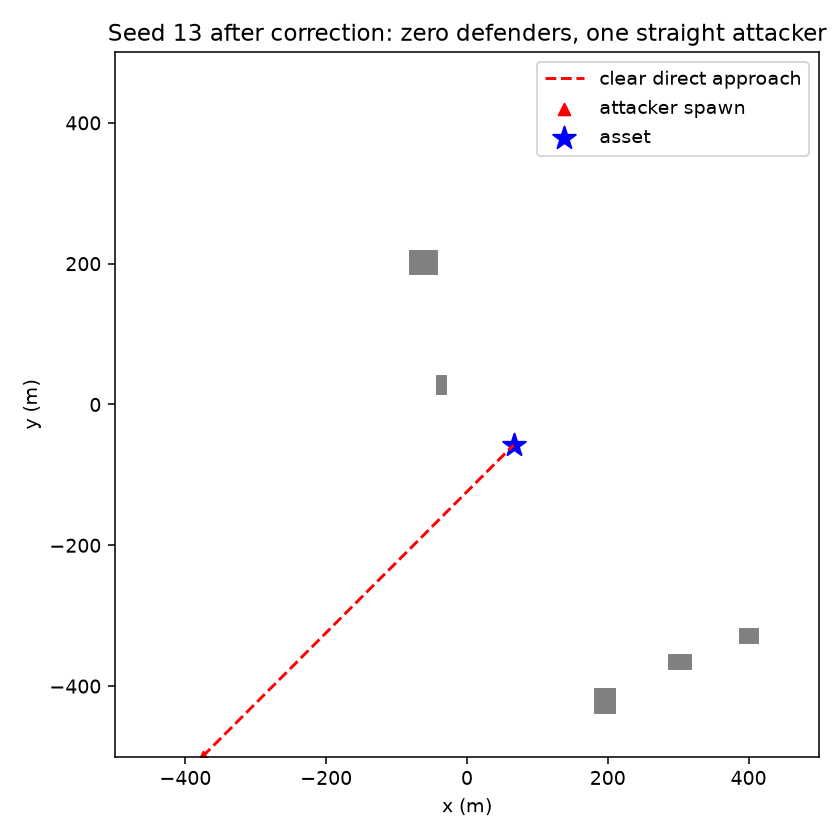

# Attackers must reach the asset without defence

The earlier swarm-level idle test hid individual failures. With **one attacker,
zero defenders**, seeds 0–199 produced 21 straight failures, no waypoint
failures, and 10 evasive failures. Every failure was a building collision;
there was no defending action. See [before.json](before.json).

Iteration: sample attacker perimeter spawns only when their direct approach has
a clear horizontal corridor to the asset. The corridor is checked against exact
inflated building footprints at every altitude, covering both cruise and dive
including descent lag. It uses the existing YAML clearance and sampling budget.
This rule applies regardless of defender count and attacker behaviour, so the
straight component of evasive and waypoint fallback are protected too. If the
sampling budget cannot produce a clear approach, reset reports an error instead
of accepting a blocked path. Collision physics and intercept rules still apply.

This intentionally conditions spawn bearings on approach feasibility. Buildings
and the asset retain their original placement rules. Hand-authored scenarios
can still explicitly place a drone on a collision course (the contact-rule test
continues to verify that it crashes). Defenders may also cause an evasive drone
to leave its nominal corridor. The guarantee concerns valid sampled episodes
without defence, not immunity to collisions.

Validation and commands are in [report.md](report.md). The prior M1 crash counts
and M3 baseline/throughput numbers describe the old sampler and should not be
used as measurements of this version.

Final outcome: **3,000/3,000** zero-defender single-attacker episodes hit the asset
(1,000 per behaviour), with no truncation. **27 C++ and 9 Python tests pass.**

