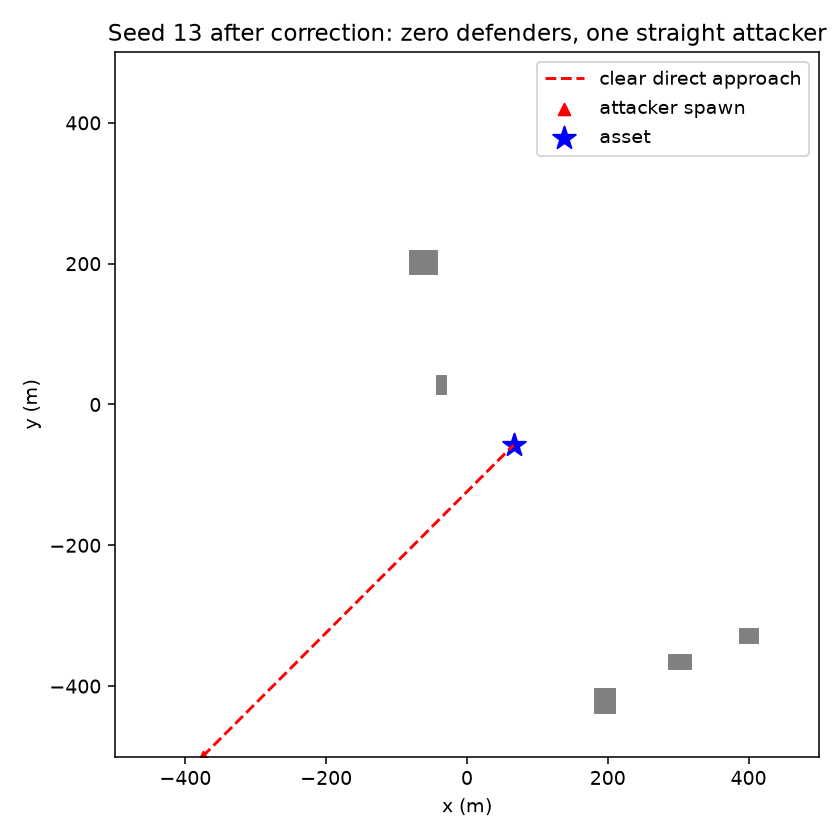

# No-defence iteration

## Reproduction and diagnosis

Before the fix:

```bash
.venv/bin/python experiments/2026-11-04_no-defence/probe.py --episodes 200 --output before
```

The recorded run predates the spawn-corridor change. It uses one attacker and
zero defenders, seeds 0–199 independently for each behaviour. The failure list
and full event tuples are preserved in `before.json`; event kind 3 / cause 2
means lost to a building. Straight: 21 failures; waypoint: 0; evasive: 10.
For example, straight seed 13 crashed at 102.70 s without hitting the asset.
Earlier multi-attacker episodes ended when another attacker hit the asset, so
the 100% swarm success rate did not establish individual script viability.

## Fix and regression checks

`sim/src/scenario.cpp` now rejects blocked direct approaches while sampling
perimeter spawns. A slab test checks both horizontal axes against each building
inflated by `max(waypoints.clearance, drone.radius)`. Extending this protection
across altitude avoids approving a roof-grazing cruise line or a blocked dive.
The shared existing `red.waypoints.max_samples` bounds spawn attempts; exhaustion
throws an explicit error. No seed is skipped in the validation sweeps.

New C++ regression: independently inflate building volumes and verify all direct
approaches from 1,000 sampled worlds are clear. Existing collision-rule tests
still pass, including the intentionally blocked hand-authored attacker route.

New Python regression: run 200 seeds per behaviour through `TeamEnv`, with one
attacker and no defenders, empty packed graphs and empty action lists. Require
asset-hit reward -1, termination, zero interceptions and no truncation. Keep the
existing idle-defender test (200 seeds per behaviour) as a separate invariant.

```bash
cmake --build --preset release -j 4
ctest --preset release
cmake --build build/python -j 4
cmake --install build/python --prefix "$PWD/.venv/lib/python3.12/site-packages"
.venv/bin/python -m pytest -q
.venv/bin/python experiments/2026-11-04_no-defence/probe.py --episodes 1000 --output after
.venv/bin/ruff check tests/test_invariant.py experiments/2026-11-04_no-defence/probe.py
```

The diagnostic script uses the unchanged `scenarios/v0/env.yaml`, overriding
only `blue_count=0`, `red_min=red_max=1`, and the selected behaviour weight. It
steps the raw simulator and requires an actual `asset_hit`, independently of
the TeamEnv reward check. Before/after seeds are the same on their shared range;
rejected spawn candidates deliberately change attacker geometry after the fix.

## Final results

| Behaviour | Before: hits / 200 | After: hits / 1,000 | After truncations |
| --- | ---: | ---: | ---: |
| straight | 179 | 1,000 | 0 |
| waypoint | 200 | 1,000 | 0 |
| evasive | 190 | 1,000 | 0 |

All 3,000 single-attacker, zero-defender episodes hit the asset. See
[after.json](after.json) and [after.log](after.log). The sweep covers seeds
0–999 per behaviour, with no skipped episodes or reset errors. No building
failures remain in this sweep.

27/27 C++ tests pass ([ctest.log](ctest.log)); 9/9 Python tests pass in 108.87 s
([pytest.log](pytest.log)). The latter includes 600 old idle-defender episodes
and 600 new zero-defender TeamEnv episodes. Ruff and codegen checks pass.

The [approach plot](approach.png), generated by `plot.py`, shows the corrected
straight approach for seed 13, one of the original failures. It depicts the
new accepted spawn and clear approach in that seed's building world.



These finite sweeps establish the tested invariant, rather than a formal proof
for arbitrary configuration values. In particular, intentionally invalid
hand-authored worlds remain subject to the physical contact rules.
