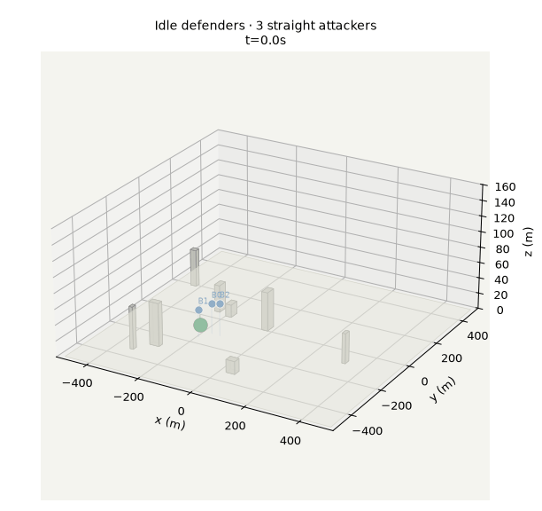
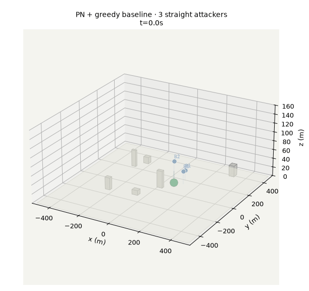
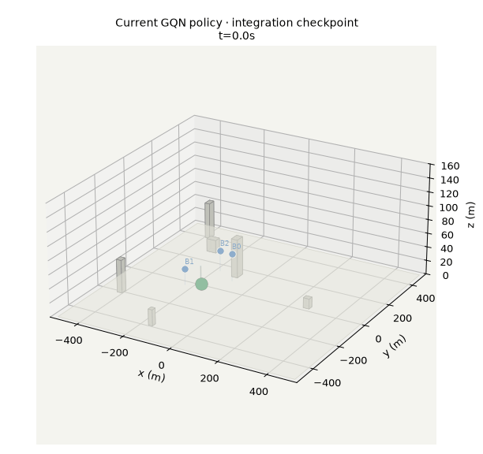

# v0 implementation review and handoff

Review date: 2026-11-04 15:57 CET
Scope: current working tree against `docs/SPEC_v0.md`
Caveat: the tree was being edited and trained against while this review ran. Two Python
training processes and one C++ baseline evaluation were still active. Statuses below are a
snapshot, not a final CI run.

## Bottom line

The foundations are real: simulation, perception, TeamEnv/VecEnv, GNC, graph layout,
ONNX export/C++ runtime, evaluation/replay, and codegen all exist and largely work. This is
not just scaffolding. But **v0 is not finished**:

- **M4 is not met.** The learner is at 0% survival in both logged attempts, versus random and
  idle at 0%. It is not yet “clearly beats random and idle”.
- **M3 is in progress.** The current 3-vs-3 table is incomplete and the new primitive-tuning
  test fails. The action primitives are not tuned yet.
- **M7 documentation is not submittable yet.** The walkthrough works, but experiment metadata,
  journal index, README results table and per-experiment reports are incomplete/inconsistent.

## Environment: how it is built and what it does

This is the part the rest of v0 is built around. The dependency chain is:

```text
core/config + core/types
        |
        v
sim::Env                 MuJoCo point-mass world, red scripts, contacts, episode rules
        |
        v
perception::Tracker      clean range-limited detections -> Kalman tracks -> fused picture
perception::build_agent  ego-centric packed observation graph
        |
        v
gnc::TeamEnv             one world + sensing + primitive decoder + baselines
        |
        v
gnc::VecEnv              N TeamEnv instances + fixed worker pool + auto-reset
        |
        v
bindings/swarmsim        Python dicts of read-only NumPy graph buffers
```

### World and reset

`sim::Env` is configured by `scenarios/v0/env.yaml` and the vendored
`scenarios/assets/x500/limits.yaml`. The current v0 world is:

- 1 km × 1 km, flat ground at z=0, z up to 150 m.
- 5–10 axis-aligned buildings, 10–40 m footprint, 10–60 m high, kept clear of the
  asset zone and the spawn ring.
- One asset sphere of radius 10 m at a random x/y in ±300 m.
- Three defenders at 50–150 m from the asset, 20–50 m altitude.
- 3–6 scripted attackers on the perimeter at 20–60 m altitude, with staggered
  spawn times in [0,10] s and cruise speeds in [6,12] m/s.
- Red behaviours: `straight`, `waypoint`, `evasive`, selected by
  `red.behaviour_weights`.

`reset(seed)` samples the scenario, rebuilds the MuJoCo model/data from scratch,
places the bodies, resets statuses/events, generates waypoint routes, and resets
the trackers, primitive decoder, fused-track identities and baseline assignments.
`TeamEnv::reset` then performs the first sensing pass and returns the initial
packed graph. There is no implicit reset in `TeamEnv`; `VecEnv` is the layer that
auto-resets finished worlds.

### Step semantics

One decision step is:

1. `TeamEnv::step(actions)` maps one action per **alive, packed defender** through
   the 27-action primitive decoder into a velocity setpoint.
2. `sim::Env::step` runs `control_per_decision = 10` controller iterations.
   Each controller iteration runs `physics_per_control = 5` MuJoCo physics steps
   of 2 ms, so a decision is 0.1 s / 50 physics steps.
3. Red behaviour scripts recompute their setpoints every controller iteration.
4. Contacts, area exits, defender–defender separation, intercept trials and the
   asset-hit rule are checked at the controller rate.
5. The episode ends when every attacker is resolved or the asset is hit. If
   `max_decisions = 3000` is reached first, the episode is marked truncated
   (bug-guard only), not terminated.
6. If all defenders die, the world keeps running until the attackers resolve the
   episode.

The team reward is exactly:

```text
reward = intercepted_this_step / initial_red_count
       - asset_hit_this_step
       + 1 if the episode ends with the asset intact (not truncated)
```

Attackers that crash into building/ground count as resolved and give no intercept
reward; the terminal intact bonus still applies if the asset survives.

### Observation graph

`perception` builds one graph per alive defender in the defender's ego frame
(translated to its position, yaw-rotated; z stays up):

- `self`: own velocity, altitude, vector to asset, distance to asset, global-view flag.
- `local_threat`: own tracker tracks, 12 features per threat.
- `asset`: one node.
- `global_threat`: fused tracks, same 12 features.
- `teammate`: other alive defenders, 8 features; the model appends the teammate
  message embedding (`d_m=16`) for the message branch.

The packed batch has separate arrays per node kind plus owner indices
(`local_owner`, `global_owner`, `teammate_owner`), `teammate_src`, `agent_env`,
`agent_drone` and `alive_mask`. There is no padding to a fixed node maximum and
no threat ID/type token in the features; node kind is represented by which
relation block the node enters. Removed agents and tracks simply disappear.

Sensing is clean but range-limited: 300 m onboard, 500 m from the asset-mounted
ground sensor. One constant-velocity Kalman tracker exists per defender plus the
ground sensor; tracks coast for 2 s then drop. Fusion is the union of all tracks
with proximity de-duplication. Baseline assignment uses TeamEnv's persistent
fused identities, not the per-sensor tracker IDs.

### Observed environment behaviour

A direct `TeamEnv` smoke check with seed 123 and the real config returned:

```text
time 0.0, n_blue 3, n_red 6
agents 3, local_threat 0, global_threat 0, teammate 6
agent_env [0,0,0], agent_drone [0,1,2]
step([13,13,13]): reward 0.0, terminated False, truncated False, intercepted 0
timings: tracking_ms ≈ 0.003, graph_ms ≈ 0.0009
```

The zero local/global threat counts at t=0 are expected: attackers spawn over
[0,10] s, so none may be visible on the first decision. Teammate nodes are
present because all three defenders are alive and connected.

Accepted environment-level measurements on the current tree:

| Check | Result |
| --- | --- |
| Idle defenders, every behaviour, 200 seeds each | Asset hit 100%, no truncation; 1,000-seed sweeps also pass |
| Single attacker, zero defenders, every behaviour, 1,000 seeds each | Asset hit 100%, no truncation |
| Random primitive policy, 1,000 episodes, 3-vs-3 straight | Survival 0%, intercept fraction ~0.0007 |
| PP + greedy, 1,000 episodes | Survival 0.410 |
| PN + greedy, 1,000 episodes | Survival 0.573 |
| Current learner | Survival 0% (`gqn` in the 3-episode M7 integration run) |

That pattern is coherent: the environment is hard for an untrained/random policy,
but the scripted PN baseline is in the intended 40–80% engineering range on this
condition. The blocker is learning, not a dead environment.

### Notable environment quirks and risks to keep in mind

- The world is recompiled at every reset (simple but costly; not yet measured as
  a runtime share).
- Attackers that crash count as resolved. With multiple attackers this is masked;
  the single-attacker invariant is what catches a broken red route.
- `TeamEnv` and `VecEnv` deliberately differ on auto-reset: `TeamEnv` requires an
  explicit reset after termination/truncation, while `VecEnv` resets automatically
  and returns the pre-reset final graph in `transitions`.
- Baseline guidance acts on fused tracks, never ground truth. Baseline and policy
  share the same perception graph, but baselines bypass the 27-action decoder and
  write velocity setpoints directly.
- `VecEnv` advances each env's seed stream by the env count on auto-reset; training
  reserves evaluation seeds starting at 10,000,000.
- `Env` owns all simulation randomness and per-world state; tracker, primitive,
  fused-ID and assignment memory live in `TeamEnv`. This is the seam intended for
  v1 save/restore.

Inspection commands:

```bash
uv run swarm-diag sim --episodes 200
# or directly:
python - <<'PY'
import swarmsim
cfg = swarmsim.EnvConfig.load('scenarios/v0/env.yaml')
env = swarmsim.TeamEnv(cfg)
print(env.reset(123).keys())
print(env.world.snapshot())
print(env.local_tracks, env.fused_tracks)
PY
```

Relevant files:

```text
core/include/core/config.hpp, core/src/config.cpp
sim/include/sim/env.hpp, sim/src/env.cpp, sim/src/scenario.cpp
perception/include/perception/perception.hpp, perception/src/perception.cpp
perception/include/perception/obs_layout.hpp
gnc/include/gnc/gnc.hpp, gnc/src/team_env.cpp, gnc/src/vec_env.cpp, gnc/src/guidance.cpp
bindings/swarmsim.cpp
tests/test_invariant.py, tests/test_team_env.py
```

## Evidence collected in this review

Commands run:

```bash
.venv/bin/python tools/codegen/generate.py --check
# codegen up to date

.venv/bin/python tools/check_dependencies.py
# C++ package dependency boundaries pass

.venv/bin/python -m pytest -q tests/test_team_env.py tests/test_policy.py tests/test_export.py
# 11 passed, 2 warnings in 4.04s

ctest --preset release
# 27/28 passed
# FAILED: PrimitiveTuning.SweepOnNonManoeuvringTargets
```

The failing sweep prints:

```text
turn_deg,speed_step,climb_step,captures,mean_episode_s
10,1.5,1.5,0,53.19
...
20,3,3,0,53.19
30,1.5,1.5,2,45.72
30,1.5,3,2,49.8233
30,3,1.5,2,47.8433
30,3,3,1,49.6267
```

It expects `best == 3`; the best observed is 2. With the current `actions.turn_deg: 20`
the PN-imitation action decoder captures none of the three test geometries. This is a real
signal that the 27-action primitive set is under-tuned, not just a cosmetic test failure.

Other current measurements:

| Area | Observation |
| --- | --- |
| M1 no-defence | 3,000/3,000 single-attacker, zero-defender episodes hit the asset after the clear-approach fix. Existing idle-defender invariant passes. |
| M2 throughput | ~9,780 env decisions/s at 32 envs / 4 threads on this WSL2 host. |
| M5 ONNX parity | M5: max absolute error 5.96e-8 over 1,000 observations. M7: 4.47e-8. |
| M5 latency | x86 WSL2: hidden 64, 12 threats, 4 teammates, p99 ~0.098 ms; `chosen_hidden=64`. x86 only; not an ARM benchmark. |
| M7 walkthrough | 7 policies × 3 episodes only; GQN 0%; PN + greedy 1.0; parity passes; duration ~16 s. This is integration evidence, not learner acceptance. |
| M3 current run | Snapshot at 15:58: idle 0/1000, random 0/1000, pp_greedy 0.41/1000, pn_greedy 0.573/1000. `pp_hungarian`, `pn_hungarian` were still running. |

## Learner diagnosis (the main blocker)

Saved M4 runs:

- `experiments/2026-11-04_m4-learner/sparse`: 200k decisions, `update_every: 16`,
  survival 0, intercept fraction 0, 12,376 updates.
- `experiments/2026-11-04_m4-learner/shaped`: 250k decisions, `shaping: 2.0`,
  survival 0 at 50k/100k/150k/200k, loss falling but no intercepts.
- The M7 8k-step policy is also 0%, as expected; the README correctly calls it integration only.
- A separate `closing` shaping run (`experiments/2026-11-04_m4-learner/closing.log`) was
  started during this review; do not treat it as a result until it finishes and is evaluated
  with the fixed 200-episode protocol.

I loaded `shaped/checkpoint-150000.pt` and ran greedy episodes. The policy overwhelmingly
chooses action 16 (climb +3 m/s, zero turn, zero speed change), and defenders leave the area
(`lost/out_of_area`) before the asset is hit. The network Q-values at reset are almost flat
across all 27 actions (roughly 2.08 for all three agents, top-vs-second difference ~0.003),
so the policy has not learned to discriminate actions.

Why this may be happening:

1. **The logged experiments are much smaller than the spec.** The spec starts at 5M decision
   steps, one update per 4 decisions, 200 eval episodes. Sparse used 200k steps and
   `update_every: 16`; shaped used `update_every: 8` and 30 eval episodes. These are
   diagnostics, not a valid M4 attempt. Run the spec-scale defaults before declaring the
   learner broken.
2. **Exploration collapse / no positive examples.** Random actions essentially never
   intercept (random intercept fraction ~0.0007 in 1,000 episodes). Sparse reward is then
   almost always negative terminal, and epsilon falls to 0.05 by 30% of the run. The policy
   can settle on a degenerate climb/out-of-area policy. Epsilon needs to stay higher longer,
   be stage-reset, or use a different exploration scheme for the M4 check.
3. **Action set may be unable to execute an intercept.** The primitive-tuning test shows that
   the current 20° turn cannot reproduce a PN intercept in three simple geometries; 30°
   captures 2/3. Tune and freeze the primitive magnitudes before spending more gradient steps.
3. **Shaping needs independent validation.** The new shared `closing_speed` shaping and
   `team_loss_penalty` are reasonable diagnostics, but must be kept as separate, logged
   experiments per spec. Check the sign/scale on a hand-authored successful intercept before
   another long run. The previous `potential` shaping still collapsed to climbing.
4. **Do not hide the problem behind a 3-episode eval.** The M4 acceptance needs 200 fixed
   evaluation episodes and a comparison to random/idle with confidence intervals.

Suggested next learner tests, in order:

1. Freeze primitives (for example 30°, or whatever the tuning sweep selects), update config,
   rerun the tiny regression and the baseline table.
2. Run a teacher-assisted sanity check: generate a few success trajectories with PN + greedy,
   verify the replay/reward contains positive intercepts, and optionally behavior-clone or
   warm-start the Q-network from them as a separate experiment.
3. Train with spec-scale `update_every=4`, at least 5M decisions, epsilon floor / stage reset,
   `eval_episodes: 200`; log Q-range, action histogram, intercept count and per-episode
   survival.
4. If still degenerate, try a shared `closing_speed` shaping run and a `team_loss_penalty`
   run separately; keep the sparse control. Do not mix multiple changes in one run.
5. Only then decide whether the learner meets “clearly beats random and idle”.

## M3/baseline findings

- The earlier 20-episode table is explicitly invalidated by the new spawn sampler. The new
  `m3-baselines` run must be the source of truth.
- The current `m3-baselines/suite.yaml` contains only `red: 3, behaviour: straight`. The spec’s
  full v0 suite has 16 conditions (3/4/5/6 attackers × straight/waypoint/evasive/mixed).
  M3 may only require “first baseline table recorded”, but M7/§8 eventually needs the full
  suite. Either run it or explicitly scope it down in `KNOWN_LIMITS.md`.
- The baseline run was still in progress. Do not cite incomplete rows as a final table.
- `pp_greedy` at 0.41 on the new sampler is lower than the old tiny-table 0.25/0.667
  figures; this confirms old numbers must not be reused.
- Primitive tuning currently uses a separate C++ test; make it an experiment journal entry and
  remove or update the failing assertion when the chosen magnitudes are frozen.

## M7/documentation/artefact gaps

The code path is present, but the acceptance documentation is not complete:

1. `experiments/README.md` only indexes m1, m2-m3-gnc, and no-defence. Missing entries for
   `2026-11-04_m2-throughput`, `m3-baselines`, `m4-learner`, `m5-runtime`, `m7-end-to-end`.
2. `experiments/2026-11-04_m7-end-to-end/` has `README.md`, `report.md`, `metrics.json`, but no
   top-level `meta.json` with git SHA, hardware, seeds, duration and commands. M7 requires a
   journal entry with commands, outputs, replay, duration, hardware and git SHA.
3. `experiments/2026-11-04_m4-learner/`, `m5-runtime/`, `m2-throughput/` and current
   `m3-baselines/` lack the complete `README.md`/`meta.json`/`report.md`/`plots/`/`episodes/`
   structure required by §11.
4. The README `<!-- results:start -->` block is still the placeholder. `swarm-report` updates
   it, but it has not been run after the latest metrics or the README was overwritten. Re-run
   `uv run swarm-report experiments/2026-11-04_m7-end-to-end` and include only labelled,
   current results.
5. `README.md` says “evaluates it and six baselines”, but the M7 walkthrough actually has
   idle/random + four classical baselines + GQN. Wording is okay if “six baselines” means
   non-GQN policies, but make it explicit.
6. `experiments/2026-11-04_m3-baselines/` and `m4-learner/` currently have no final
   README/report; old `m2-m3-gnc` report claims full-suite work is later. Keep that clear.
7. `docs/KNOWN_LIMITS.md` is useful and mostly honest. Keep it; add the primitive-tuning
   failure and the current learner status if they persist.

## Command/API issues worth fixing

1. `swarm-eval --suite v0`: the `--suite` argument is parsed but ignored; the default
   `--config scenarios/v0/eval.yaml` is what actually runs. Either resolve suite names to
   configs or remove the flag and document the config path.
2. `swarm-eval --run <wandb-or-path>`: only local paths work; a W&B URL is passed to
   `Path(...)`. The spec command says `<wandb-or-path>`. Implement run resolution via
   `wandb.Api`, or document local-only and change the command text.
3. Replay of baseline recordings: `episode()` writes `decisions=np.asarray([])` for
   non-policy runs. `_to_json` assumes a sequence and can fail on a 0-d array. Guard empty
   decision logs in `replay.py`.
4. `--cpp` evaluation and interpretability recording are split: `evaluate.py` reruns a Python
   episode for the first N records after the C++ evaluation. That is fine for speed, but
   document that `--cpp` metrics and recorded decisions come from separate runs.
5. Baseline latency includes environment stepping; GQN inference latency excludes it. This is
   documented in `KNOWN_LIMITS`, but report tables should label it or use the dedicated
   `swarm-bench --what latency` numbers consistently.
6. `swarm-replay --viewer` is only exercised by code inspection; run it on a machine with a
   display, or explicitly mark it untested. The HTML replay is the tested fallback.

## Build/tooling observations

- `pyproject.toml` requires exactly Python 3.12, while the spec says 3.11+. Either support
  3.11+ or document the deviation.
- `tools/check_dependencies.py` checks includes only, not CMake target visibility. The CMake
  target graph currently looks correct, but the CI claim is weaker than the spec’s
  “enforced by CMake target visibility and a CI check”. Add a target-level check if time
  permits.
- CI exists and covers build, tests, codegen, dependency check, ONNX parity via pytest, and a
  short walkthrough. It does not run the full 16-condition eval or ARM latency; that is
  acceptable for v0 if documented.
- The CMake ONNX Runtime and MuJoCo fetches are Linux-x64-specific. `KNOWN_LIMITS.md` already
  says ARM/macOS are unvalidated. Keep that explicit.

## Recommended order of work

1. **Green the tree.** Finish the primitive tuning decision; make `ctest` and `pytest` green.
   Update `scenarios/v0/env.yaml` if action magnitudes change, then rerun M3 baselines.
2. **Make the M3 table current.** Complete the running baseline suite, write a short M3
   README/report with the new sampler, and mark the old table obsolete.
3. **Make a real M4 attempt.** Use spec-scale updates/steps/eval episodes, log Q ranges and
   action histograms, and run shaping only as a separate experiment. Acceptance is a
   statistically clear margin over random and idle on 3-vs-3 straight.
4. **Finish M7 artefacts.** Add top-level `meta.json`, commands/hardware/git SHA/duration,
   update `experiments/README.md`, regenerate the README results table, and run the
   clean-checkout walkthrough once more. Test HTML replay and, if display hardware exists,
   the MuJoCo viewer.
5. **Keep scope cuts explicit.** Reasonable cuts: full online W&B, MuJoCo viewer as default,
   ARM/local latency, full 16-condition suite until M7, macOS. Do not cut ONNX parity,
   variable team sizes, codegen consistency, interpretability logging, or the end-to-end
   walkthrough.

## Animated demos

Three real-environment GIFs are in [gifs/](gifs/):







They show real `TeamEnv` episodes as 3D perspective views: world x/y/z axes,
3D building boxes, ground asset, defenders, attackers, altitude stems and full
flight trails:

| GIF | Seed | Policy | Outcome |
| --- | ---: | --- | --- |
| `idle_asset_hit.gif` | 23 | idle | asset hit at 26.8 s |
| `pn_greedy_defence.gif` | 24 | PN + greedy | asset intact at 39.6 s; all 3 defenders survive |
| `gqn_current_policy.gif` | 10,000,000 | M7 GQN checkpoint | asset hit at 52.2 s; all defenders lost |

The GQN clip is intentionally a current-state diagnostic, not a success claim.
The renderer is `experiments/2026-11-04_v0-review/make_gifs.py`; it uses the real
`TeamEnv` state snapshots and renders them in 3D, not as a top-down projection.

## Task-suite proposal

A separate analysis of the proposed 2D / 3D point-mass / 3D rigid-body suite is in
[TASK_SUITE_ANALYSIS.md](TASK_SUITE_ANALYSIS.md). Summary: the current environment is
already 3D point mass, not 2D; v1 is deliberately point-mass; 3D rigid body belongs to
the v2 `rigid-body` module. Do not add the suite before v0/v1; use MPE2 `simple_tag`
for a 2D sanity check, and implement the fidelity ladder as a v2 experiment if the
research question justifies it.

## External environment suites checked online

A separate survey is in [ENV_SUITE_SURVEY.md](ENV_SUITE_SURVEY.md), with a
licence/reuse analysis in [REUSE_ANALYSIS.md](REUSE_ANALYSIS.md). Short version:
there is **no exact maintained benchmark** for 3D drone asset defence with limited
perception and graph observations. The closest task is **MARSim** (grid-based,
small/new); the closest benchmark semantics are **MPE2 `simple_tag` /
`simple_world_comm`**; the closest drone-control environments are
**gym-pybullet-drones**, **PyFlyt** and **Aerial Gym Simulator**. SMAC/SMACv2 are
useful cooperative-MARL protocol references, not drone suites.

## What is actually in good shape

- C++/Python graph boundary and buffer lifetime; packed graphs; auto-reset retains final
  observations.
- GNC primitives, PP/PN, greedy/Hungarian, TeamEnv/VecEnv; core test coverage is meaningful.
- Perception tracker/fusion and no-defence invariant.
- ONNX dynamic/empty-graph export and native C++ parity.
- Evaluation runner, metrics/CI, NPZ recording and HTML replay.
- Codegen and dependency checks.
- Honest `KNOWN_LIMITS.md` and the experiment journals that do exist.

The remaining work is concentrated in the learner, primitive tuning, and final evidence/
journal hygiene — not in rebuilding the core stack.
