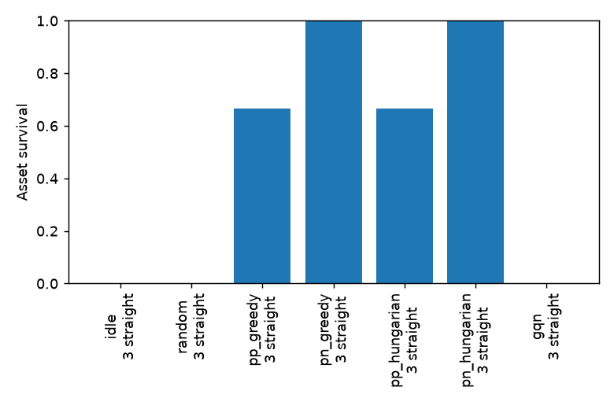

# Evaluation report

| Policy | Red | Behaviour | Survival (95% CI) | Intercept fraction | Truncated |
| --- | ---: | --- | --- | ---: | ---: |
| idle | 3 | straight | 0.000 [0.000, 0.562] | 0.000 | 0 |
| random | 3 | straight | 0.000 [0.000, 0.562] | 0.000 | 0 |
| pp_greedy | 3 | straight | 0.667 [0.208, 0.939] | 0.889 | 0 |
| pn_greedy | 3 | straight | 1.000 [0.438, 1.000] | 1.000 | 0 |
| pp_hungarian | 3 | straight | 0.667 [0.208, 0.939] | 0.889 | 0 |
| pn_hungarian | 3 | straight | 1.000 [0.438, 1.000] | 1.000 | 0 |
| gqn | 3 | straight | 0.000 [0.000, 0.562] | 0.000 | 0 |

